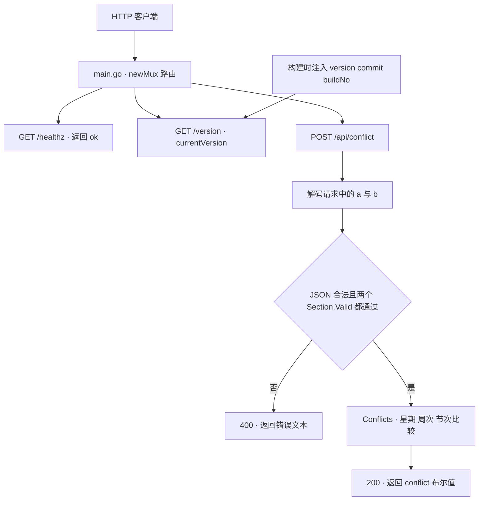
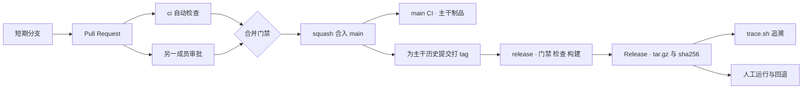
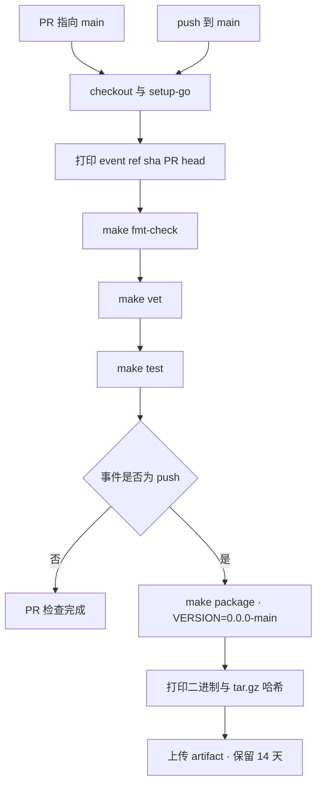

# SE3309 实验 1 项目说明与答辩手册

SE3309 实验 1  从提交到可追溯制品的流水线

第 13 组  |  答辩准备版  |  核验日期：2026 年 10 月 22 日（UTC+8）

## 项目概览

### 项目一句话说明

本项目以 Go 编写的选课时间冲突检查服务为载体，建立了从提交代码、自动检查、人工审批，到生成制品、发布版本、追溯来源和切换旧版本的完整实验流程。它要解决的核心问题是：拿到一个程序包，或看到一个正在运行的服务时，能否明确指出它来自哪次提交、哪个 PR 和哪次构建。

### 答辩应抓住的主线

服务本身负责判断两个教学班的时段是否冲突；交付流程负责保证代码在进入 main 前经过检查，发布提交属于 main 历史，并把源码身份写入最终程序和压缩包。两部分通过 Makefile、构建参数和版本查询接口连接起来。

| 层面 | 本项目实际内容 |
| --- | --- |
| 应用功能 | 无状态 HTTP 服务；校验两个时段；计算冲突；提供存活与版本查询。 |
| 工程实现 | ci.yml、release.yml、GitHub 主干规则、补充测试、版本接口禁缓存。 |
| 实验记录 | 两轮 gate 演练、两个 Release、哈希对照、追溯与回退记录。 |
| 范围边界 | 没有前端、数据库、真实选课系统或自动生产部署；Dockerfile 是选做模板。 |

### 本说明的依据

代码基线为 main 提交 [`a42db72`](https://github.com/SS80194/SE3309_2026_lab1/commit/a42db721c8e957857eb8e87b8410ef1d79b2b2dd)。本文中的“当前”、PR 数量与发布状态均指该核验快照，后续变化请以仓库和 GitHub 记录为准。实验要求来自课程 Canvas 发布的《实验 1：从提交到可追溯制品的流水线》指导书；项目事实来自仓库源码、LAB1.md、GitHub PR、Actions 和 Release。本文区分当前源码、已发布版本以及仓库记录的历史实验，不把报告中的记录等同于本次重新执行。

[项目仓库  SS80194/SE3309_2026_lab1](https://github.com/SS80194/SE3309_2026_lab1)

阅读建议：第一次阅读先看第 1 至 5 节建立整体认识；负责流水线的同学重点看第 6 至 16 节；所有成员答辩前都应练习第 19 至 22 节的讲解与追问。

## 1 阅读导航与代码地图

### 术语速查

| 术语 | 在本项目中的含义 |
| --- | --- |
| PR | Pull Request，提出代码改动并邀请他人评审的合并请求 |
| CI | 持续集成，每次改动后自动执行格式、静态检查和测试 |
| gate | 门禁，条件满足才允许继续合并或发布 |
| runner | GitHub Actions 实际执行命令的运行机器 |
| artifact 或制品 | 构建产物，例如包含程序与 BUILD_INFO 的 tar.gz |
| tag 与 Release | tag 标记一个 Git 提交；Release 以该标签为入口保存版本说明和附件 |
| SHA 与 SHA-256 | Git 提交 SHA 标识提交对象；文件 SHA-256 是文件内容的校验摘要，二者不可混用 |
| squash | 把一个 PR 的净改动合并成 main 上的一个新提交 |
| dirty 工作区 | 存在尚未提交修改的源码工作区 |

| 章节 | 阅读内容 |
| --- | --- |
| 2 至 5 | 总体架构、数据与算法、HTTP 接口、测试组织 |
| 6 至 9 | CI 流水线、合并门禁、两轮演练、发布工作流 |
| 10 至 14 | 构建打包、版本信息、制品追溯、发布差异、回退 |
| 15 至 18 | 重复构建、测量分析、成员贡献、限制与改进 |
| 19 至 22 | 答辩讲解顺序、常见追问、现场准备清单 |
| 23 | 源代码与原始运行记录的链接索引 |

### 章节目录

- [1 阅读导航与代码地图](#1-阅读导航与代码地图)
- [2 总体架构与设计取舍](#2-总体架构与设计取舍)
- [3 时段数据模型与冲突算法](#3-时段数据模型与冲突算法)
- [4 HTTP 接口与请求执行过程](#4-http-接口与请求执行过程)
- [5 自动化测试如何覆盖行为](#5-自动化测试如何覆盖行为)
- [6 CI 工作流的具体实现](#6-ci-工作流的具体实现)
- [7 合并门禁与提交身份](#7-合并门禁与提交身份)
- [8 两轮门禁演练证明了什么](#8-两轮门禁演练证明了什么)
- [9 发布工作流与发布门禁](#9-发布工作流与发布门禁)
- [10 Makefile 如何构建可追溯制品](#10-makefile-如何构建可追溯制品)
- [11 版本信息如何贯穿程序与制品](#11-版本信息如何贯穿程序与制品)
- [12 trace 脚本的追溯实现](#12-trace-脚本的追溯实现)
- [13 两个已发布版本与追溯示例](#13-两个已发布版本与追溯示例)
- [14 运行与回退怎样演示](#14-运行与回退怎样演示)
- [15 本地基线与可重复构建实验](#15-本地基线与可重复构建实验)
- [16 CI 成本与实验数据分析](#16-ci-成本与实验数据分析)
- [17 小组贡献与版本演进](#17-小组贡献与版本演进)
- [18 当前限制与可讨论的改进](#18-当前限制与可讨论的改进)
- [19 二十分钟答辩的讲解顺序](#19-二十分钟答辩的讲解顺序)
- [20 常见追问与回答要点一](#20-常见追问与回答要点一)
- [21 常见追问与回答要点二](#21-常见追问与回答要点二)
- [22 现场演示准备与核对清单](#22-现场演示准备与核对清单)
- [23 代码与证据索引](#23-代码与证据索引)

### 项目文件各自负责什么

| 文件 | 职责 | 答辩时应解释的内容 |
| --- | --- | --- |
| conflict.go | 业务模型与纯函数 | Section、Valid、weeksOverlap、Conflicts |
| main.go | HTTP 与启动入口 | 三个接口、版本变量、命令行参数 |
| conflict_test.go | 业务测试 | 9 组冲突用例、合法性检查、星期边界 |
| main_test.go | HTTP 测试 | 状态码、冲突返回、版本响应头 |
| Makefile | 共享构建入口 | 格式、静态检查、测试、编译、归档和哈希 |
| .github/workflows/ci.yml | PR 与 main 的自动检查 | 触发条件、分步检查、仅 main 打包 |
| .github/workflows/release.yml | 标签触发发布 | 主干归属检查、正式版本构建、附件发布 |
| scripts/trace.sh | 从制品反查源码 | 校验、读取 BUILD_INFO、Git 历史、链接 |
| go.mod | Go 模块声明 | 最低 Go 版本 1.26，无第三方依赖 |
| LAB1.md | 实验记录与分析 | 门禁、版本、测量、哈希和成员贡献 |
| Dockerfile | 选做容器模板 | 复制已有二进制，当前未形成镜像发布流程 |

[README.md](../README.md) 提供服务说明、本地命令和本文入口；流水线实现见 .github/workflows 下的文件。目录中出现 Dockerfile，不能据此推断已完成容器镜像发布。

## 2 总体架构与设计取舍

### 运行时架构



图 1 运行时只处理一对时段，没有数据库或外部服务依赖。

程序是一个 Go 可执行文件。main 解析启动参数，调用 newMux 创建路由，然后由 net/http 启动服务器。业务函数接收值并返回结果，不读写文件、不查询数据库，也不依赖登录状态。每次请求都带齐计算所需数据，因此当前服务是无状态的。

### 交付架构



图 2 应用交付分为合并路径和发布路径，发布不等于自动部署。

运行时与交付时的连接点是编译参数：流水线把版本、提交和构建号传给 Makefile，Makefile 再把这些字符串写入二进制，同时生成 BUILD_INFO。运行服务可查 /version；未运行的包可由 trace.sh 读取 BUILD_INFO。

### 为什么采用这个结构

Go 标准库足以表达本实验所需接口，依赖少，便于快速重复构建。纯业务函数与 HTTP 层分开，既能直接测试规则，也能测试 JSON 到业务函数的连接。Makefile 同时服务本地和 CI，减少两套命令不一致；两个工作流分别承担验证与发布责任，权限也随之区分。

## 3 时段数据模型与冲突算法

| 字段 | 含义 | 实际约束 |
| --- | --- | --- |
| id | 教学班标识字符串 | 仅保留为输入标识；不参与校验和冲突判定，响应也不返回它 |
| weekday | 星期几 | 整数 1 至 7；1 是周一，7 是周日 |
| start | 起始节次 | 整数，至少为 1 |
| end | 结束节次 | 不小于 start；没有设定每天最大节次数 |
| weeks | 上课周次模式 | 只接受 all、odd、even，分别表示每周、单周、双周 |

Section 表示一个教学班在一周中的一个上课时段。它没有课程容量、地点、学生、学期起止周等字段；同一门课有多个时段时，当前接口不会自动展开比较。调用者必须先用 Valid 保证输入合法，Conflicts 本身不重复校验。

### 冲突成立需要三个条件同时满足

第一，两个时段在同一星期。第二，它们实际出现的周次有交集：任一方为 all 时有交集；否则必须同为 odd 或同为 even。第三，两个节次区间重叠。这里 start 和 end 都包含在区间内，因此第 2 节结束与第 2 节开始仍然冲突。

```go
func Conflicts(a, b Section) bool {
    if a.Weekday != b.Weekday { return false }
    if !weeksOverlap(a.Weeks, b.Weeks) { return false }
    return a.Start <= b.End && b.Start <= a.End
}
```

区间公式可以反过来理解：不重叠只有 a 完全在 b 前面或 b 完全在 a 前面，即 a.End < b.Start 或 b.End < a.Start。对它取反，就得到代码中的两个小于等于条件。

| 输入关系 | 结果 | 原因 |
| --- | --- | --- |
| 同周一，all，[1,2] 与 [2,3] | 冲突 | 第 2 节交叉，边界包含在内 |
| 同周一，all，[1,2] 与 [3,4] | 不冲突 | 节次之间没有公共元素 |
| 同周一、同节次，odd 与 even | 不冲突 | 周次集合没有交集 |
| 同节次，周一与周二 | 不冲突 | 星期不同 |
| 同一天同节次，all 与 odd | 冲突 | 每周包含单周 |

单次判断只做固定次数的比较，时间和额外空间都是 O(1)，即不随课程数量增长。如果未来要检查 n 个时段，外层两两比较会是 O(n²)；这属于后续扩展，当前代码没有实现。

[代码依据：conflict.go，第 3–55 行](https://github.com/SS80194/SE3309_2026_lab1/blob/a42db721c8e957857eb8e87b8410ef1d79b2b2dd/conflict.go#L3-L55)

## 4 HTTP 接口与请求执行过程

| 入口 | 输入与输出 | 作用 |
| --- | --- | --- |
| GET /healthz | 成功返回 200 和文本 ok | 确认进程能响应；不是外部依赖就绪检查 |
| GET /version | JSON 包含 version、commit、build_no、go | 识别实际运行程序；当前 main 带 no-store 响应头 |
| POST /api/conflict | 请求为 a、b 两个 Section；响应为 conflict | 执行输入校验与冲突计算 |
| -version 参数 | 打印一行版本信息后退出 | 不用启动 HTTP 即可检查二进制身份 |
| -addr 参数 | 默认 :8080，可设 127.0.0.1:18080 | 设置监听地址；演示时可限制为本机访问 |

### 业务请求按什么顺序处理

newMux 中的处理器先把请求体解码到包含 A、B 的结构体。解码失败返回 400 和“请求体不是合法的 JSON”；任一时段不合法返回 400 和“时段不合法”。两者都合法才调用 Conflicts，设置 JSON 类型并编码结果。业务错误是明确的客户端错误，不会继续进入冲突计算。

```bash
curl -sS -X POST http://127.0.0.1:18080/api/conflict \
  -H 'Content-Type: application/json' \
  -d '{
    "a":{"id":"A","weekday":1,"start":1,"end":2,"weeks":"odd"},
    "b":{"id":"B","weekday":1,"start":1,"end":2,"weeks":"even"}
  }'
# 预期结果：{"conflict":false}
```

把两个 weeks 都改为 all，上述同一时段的请求应得到 true；把任一 weekday 改为 8，应得到 400。这里的响应是依据源码给出的演示预期，本次文档制作没有启动该服务做新的端到端实测。

### 版本接口为什么增加禁缓存

PR #6 在 /version 上设置 Cache-Control: no-store，并添加响应头断言。这个接口用来判断当前运行的是哪个版本，要求中间层和客户端不要存储该响应，避免在切换版本时看到旧结果。此改动已经进入当前 main，尚未包含在 v1.0.0 或 v1.0.1 中。

### 接口边界

当前只解码一次 JSON，没有启用未知字段拒绝、严格的尾随内容检查或请求体大小限制；ID 不要求非空。不要把这个教学接口描述为完整输入安全框架。路由由标准库按方法和路径匹配，HTTP 层没有身份认证、数据库访问或课程列表接口。

[代码依据：main.go，第 32–80 行](https://github.com/SS80194/SE3309_2026_lab1/blob/a42db721c8e957857eb8e87b8410ef1d79b2b2dd/main.go#L32-L80)

## 5 自动化测试如何覆盖行为

| 测试入口 | 实际覆盖 | 为什么这样设计 |
| --- | --- | --- |
| TestConflicts | 9 组同日、不同日、节次边界和周次组合；每组交换参数再测 | 直接验证纯业务函数，并检查冲突关系的对称性 |
| TestValid | 合法样本；weekday=0/8、start=0、end<start、非法 weeks | 保证错误数据在业务入口前被拒绝 |
| TestValidWeekdayBoundaries | -1、0、1、6、7、8 六个星期取值 | 补上合法上界 7 的缺口，同时保留非法边界 |
| TestHealthz | GET /healthz 返回 200 | 验证路由能响应存活请求 |
| TestVersionEndpoint | JSON 可解析，关键字段非空，no-store 响应头 | 验证版本查询可用及当前 main 的禁缓存行为 |
| TestConflictEndpoint | 单双周不冲突、节次重叠冲突、坏 JSON 和非法时段 400 | 验证 HTTP 处理器确实连接了解码、校验与计算 |

### 测试怎样执行

HTTP 测试使用 httptest.NewRequest 和 NewRecorder，把请求直接交给真实 newMux 处理。它没有绑定端口，也没有启动真实网络连接，但路由、JSON 处理、Valid 与 Conflicts 都是真实代码。它适合稳定地检查接口行为，不能替代真实部署、代理缓存或跨机器访问验证。

```makefile
fmt-check:
	@out="$$(gofmt -l .)"; \
	if [ -n "$$out" ]; then echo "以下文件需要 gofmt："; echo "$$out"; exit 1; fi

vet:
	go vet ./...

test:
	go test -count=1 ./...
```

gofmt -l 只列出需要格式化的文件，发现问题时不一定返回非零；Makefile 检查它的输出是否非空，并主动 exit 1，使 CI 失败。go vet 检查编译之外的常见可疑写法；go test 验证已写出的行为断言。-count=1 避免直接复用先前的测试结果缓存。三个步骤分开运行，所以失败记录能明确指出停在格式、静态检查还是测试。

### 能证明什么与尚不能证明什么

当前 main 的 CI #25 已核对为成功，格式、vet、测试、打包和上传步骤均通过。本次没有在本机重新跑 Go 测试，也没有重新进行旧版与修复版的对照；第二轮回归证据使用仓库保留的三阶段提交及对应 Actions 运行。

测试未证明任意输入都正确，也没有给出负载、并发压力、真实代理缓存、恶意大请求等验证。100% 的一次运行通过率只说明这组断言通过，不能换成“系统没有缺陷”。

[代码依据：conflict_test.go](https://github.com/SS80194/SE3309_2026_lab1/blob/a42db721c8e957857eb8e87b8410ef1d79b2b2dd/conflict_test.go)

[代码依据：main_test.go](https://github.com/SS80194/SE3309_2026_lab1/blob/a42db721c8e957857eb8e87b8410ef1d79b2b2dd/main_test.go)

[当前 main 的 CI #25](https://github.com/SS80194/SE3309_2026_lab1/actions/runs/39714064973)

## 6 CI 工作流的具体实现

CI 即持续集成：每次提交到需要集成的路径后，自动运行同一套检查。ci.yml 监听面向 main 的 pull_request，以及推送到 main 的 push。没有 paths 或 paths-ignore 过滤，文档修改也会触发检查。job 名为 ci，主干规则把这个名称设为必需检查。



图 3 同一个 ci job 中，打包和上传步骤只在 push 事件执行。

### 为什么 PR 不产生主干制品

PR 上的检查是在验证候选改动；其临时合并提交和分支提交不一定最终进入 main。合入以后才以 main 的 github.sha 构建制品，保证 BUILD_INFO 指向稳定的主干历史。条件只写 event_name == push 仍然足够，是因为此工作流的 push 触发器已经限定 main。

```yaml
- name: Build package
  if: github.event_name == 'push'
  env:
    BUILD_NO: ${{ github.run_number }}
    RUN_ID: ${{ github.run_id }}
    COMMIT_SHA: ${{ github.sha }}
  run: |
    make package VERSION=0.0.0-main \
      BUILD_NO="$BUILD_NO" RUN_ID="$RUN_ID" COMMIT="$COMMIT_SHA"
```

上传的内容为 dist/*.tar.gz 和 dist/*.tar.gz.sha256；artifact 名包含提交号与构建号，保留 14 天，找不到文件时按错误处理。CI 日志还分别打印二进制与归档的 SHA-256，便于比较“程序相同”与“压缩包相同”。

### 环境与权限

runner 固定为 ubuntu-24.04，Go 固定为 1.26.9；checkout、setup-go、upload-artifact 使用 @v7。这里固定了操作系统系列和 Go 补丁号，但没有固定 runner 镜像内容或 Action 的完整提交 SHA。CI 只需要 contents: read，不具备创建 Release 所需的 contents: write。

[代码依据：.github/workflows/ci.yml](https://github.com/SS80194/SE3309_2026_lab1/blob/a42db721c8e957857eb8e87b8410ef1d79b2b2dd/.github/workflows/ci.yml)

## 7 合并门禁与提交身份

merge gate 是合并门禁：main 只接受通过规则的 PR。protect-main 规则当前为 Active，作用于默认分支；要求至少一位其他成员审批，要求 ci 通过，同时禁止删除和强制推送。仓库当前只允许 squash 合并，即把一个 PR 的净改动合成 main 上的一个提交。

LAB1.md 记录 Bypass list 为空；本次规则 API 返回当前调用者不可绕过，但未返回完整 bypass_actors 列表，因此没有独立确认所有主体的旁路配置。当前规则也没有要求每次推送都重新审批，或合并前必须把分支更新到最新 main，不应增加这些未启用的条件。

| 条件 | 防止的问题 | 仍依赖什么 |
| --- | --- | --- |
| 必须通过 PR | 直接绕过评审修改 main | 规则持续启用，且没有绕过主体 |
| 至少 1 人审批 | 作者单独决定合入自己的代码 | 审批人真正理解需求和改动 |
| 必需检查 ci | 已写测试能发现的错误进入 main | 测试断言足够有效 |
| 禁止强推和删除 | 主干历史被轻易改写或移除 | 仓库设置和管理操作得到维护 |

LAB1.md 保留了管理员直接推送 main 被 GH013 拒绝的终端输出。本次读取规则和历史记录，没有重新向 main 推送试探提交。规则入口见 [protect-main](https://github.com/SS80194/SE3309_2026_lab1/rules/25530812)。现场检查应在独立、干净克隆中进行，避免影响日常工作区。

### 为什么三个提交号不一样

| PR #1 中的身份 | 缩写 | 含义 |
| --- | --- | --- |
| pull_request.head.sha | 90874f8 | 开发分支上的修复提交 |
| PR 运行中的 github.sha | c6bb30b | GitHub 为 PR 检查生成的临时合并提交 |
| squash 后 main 的提交 | 5276085 | 真正进入主干的净变更提交 |

默认 PR 检查验证的是临时合并结果，因此 github.sha 不等于分支头。随后 squash 又创建新的主干提交。对于这个 PR，前两者都不是 main 历史的祖先；发布追溯应引用第三者，而不是把 PR 检查中打印的 SHA 直接当作最终交付身份。

PR #1 的主干提交标题虽然以“Merge pull request”开头，但它只有一个父提交。判断合并方式要看提交图和仓库设置，不能只看可编辑的标题。类似地，提交标题并不保证含有 (#编号)；必要时通过 GitHub 的提交关联 PR 或 PR 页面确认对应关系。

[代码依据：LAB1.md](https://github.com/SS80194/SE3309_2026_lab1/blob/a42db721c8e957857eb8e87b8410ef1d79b2b2dd/LAB1.md)

[PR #1 及其合入记录](https://github.com/SS80194/SE3309_2026_lab1/pull/1)

[GitHub 官方说明  PR 检查中的合并提交](https://docs.github.com/en/actions/reference/workflows-and-actions/events-that-trigger-workflows#pull_request)

## 8 两轮门禁演练证明了什么

### 第一轮  已有测试发现错误

小组故意破坏周次相交逻辑，使同一时段的单周和双周可能被判为冲突。已有测试能够检测这一错误，PR #1 的 ci #2 因测试失败而失败。随后追加修复，ci #3 通过，经其他成员审批后 squash 合入；main 上 ci #5 再次检查并产生制品。最终 main 保留新增用例，没有保留注入的错误。

| 阶段 | 运行 | 结果与含义 |
| --- | --- | --- |
| 注入缺陷 | 39568009947 | 失败 19 秒；证明现有测试可发现此错误 |
| 修复同一 PR | 39568759228 | 成功 17 秒；修复后候选改动通过 |
| 合入 main | 39570884805 | 成功；最终主干身份被重新验证并打包 |

### 第二轮  先展示漏测再补回归

PR #2 把 Section.Valid 的上界从 weekday > 7 改成 weekday > 6，于是合法的周日被错误拒绝。旧测试只检查周三合法和 0、8 非法，因而代码已经错了，CI 仍然通过。小组随后添加星期边界测试，让它准确失败，再撤销业务缺陷，保留新测试。

| 阶段 | 提交与运行 | 实际结果 |
| --- | --- | --- |
| 有错误 仅旧测试 | 84fe211 / 39574266980 | 成功，暴露覆盖缺口 |
| 有错误 增加边界测试 | afdc3da / 39574372699 | 失败，周日有效的断言被破坏 |
| 撤销错误 保留测试 | 9cd02da / 39574475189 | 成功，说明修复与回归测试匹配 |

```text
--- FAIL: TestValidWeekdayBoundaries/周日有效
Section.Valid(weekday=7) = false, want true
```

六个边界输入为 -1、0、1、6、7、8。最终 conflict.go 与演练前相同，保留下来的价值是测试覆盖。该缺陷是为了实验主动注入的，不应说成“原始 main 存在周日错误”。

### 门禁的收益取决于检查的内容

第一轮说明测试失败能阻止合并；第二轮说明 CI 为绿色不等于需求正确。门禁负责执行规则，测试负责描述可自动判断的正确性，人工评审负责检查测试未覆盖的需求理解和方案。三者不能互相替代。

[第一轮 PR #1](https://github.com/SS80194/SE3309_2026_lab1/pull/1)

[第二轮 PR #2](https://github.com/SS80194/SE3309_2026_lab1/pull/2)

## 9 发布工作流与发布门禁

release.yml 在推送匹配 vX.Y.Z 形式的 tag 时执行。标签过滤使用 GitHub 的匹配语法，不能把它当作完整的语义化版本校验器。整个工作流只有一个 release job：取代码、检查主干归属、安装工具链、格式检查、vet、测试、正式版本打包，最后创建 Release。

### 发布门禁在哪里执行

```text
- uses: actions/checkout@v7
  with:
    fetch-depth: 0

if ! git merge-base --is-ancestor "$GITHUB_SHA" origin/main; then
  echo "Release gate: tag 指向的提交不在 main 的历史上，禁止发布"
  exit 1
fi
```

fetch-depth: 0 获取完整历史，否则浅克隆可能缺少判断祖先关系所需的提交。--is-ancestor 检查 tag 对应提交是否属于 main 的历史，包括当前 tip 或更早的祖先；它不要求标签一定打在最新 main 上。

小组曾在未合入分支上打测试 tag，对应运行 39583519545 在 Release gate 步骤失败，后面的构建和发布没有执行。这证明该工作流能拒绝这个具体的非主干发布场景。它并不自动判断任意代码是否可信，仍依赖标签权限、工作流完整性和合并规则。

### 正式版本与附件怎样产生

```bash
VERSION="${TAG_NAME#v}"
make package VERSION="$VERSION" \
  BUILD_NO="$BUILD_NO" RUN_ID="$RUN_ID" COMMIT="$COMMIT_SHA"

gh release create "$TAG_NAME" \
  dist/*.tar.gz dist/*.tar.gz.sha256 \
  --title "$TAG_NAME" --notes "Release $TAG_NAME"
```

TAG_NAME 取 github.ref_name，去掉 v 后注入二进制。BUILD_NO、RUN_ID、COMMIT 分别取工作流运行号、运行 ID 和该事件的提交号。GH_TOKEN 使用 GitHub 提供的 token，权限声明为 contents: write，满足创建 Release 的要求。

### 发布为什么又构建一次

main 的 CI 制品内写的是 0.0.0-main；正式发布需要 1.0.0 这样的版本号，因此本实验在 tag 上重新编译。这样容易理解，但严格说没有做到“一次构建、多处部署”：二进制输入变了，还会增加工具链或环境漂移的机会。后续若要改成制品晋级，需要重新设计版本元数据与交付流程。

[代码依据：.github/workflows/release.yml](https://github.com/SS80194/SE3309_2026_lab1/blob/a42db721c8e957857eb8e87b8410ef1d79b2b2dd/.github/workflows/release.yml)

[发布门禁拒绝记录](https://github.com/SS80194/SE3309_2026_lab1/actions/runs/39583519545)

## 10 Makefile 如何构建可追溯制品

### 统一入口与依赖顺序

make package 依赖 build，因此先创建目标目录并编译，再生成 BUILD_INFO、归档和校验文件。注意 package 自身不依赖 fmt-check、vet 或 test；CI 和 release 是在前面的步骤显式执行这些检查。本地只运行 make package，不能声称已经完成质量检查。

```makefile
LDFLAGS := -X main.version=$(VERSION) \
           -X main.commit=$(COMMIT) -X main.buildNo=$(BUILD_NO)

CGO_ENABLED=0 GOOS=$(GOOS) GOARCH=$(GOARCH) \
  go build -trimpath -ldflags "$(LDFLAGS)" \
  -o $(DIST)/$(PKG)/$(NAME) .
```

| 参数或变量 | 具体作用 |
| --- | --- |
| GOOS=linux  GOARCH=amd64 | 确定默认目标平台；产物不能直接在 macOS 上原生运行 |
| CGO_ENABLED=0 | 关闭 C 代码互操作；本项目仅用 Go 标准库，便于独立交付 |
| -trimpath | 移除编译结果中的本机文件系统路径，减少路径差异 |
| -ldflags 与 -X | 在链接时设置 main 包中的三个字符串变量 |
| COMMIT 的缺省值 | 使用 git rev-parse HEAD；流水线显式传入 github.sha |
| RUN_ID | 写入 BUILD_INFO，用于构造构建运行链接；没有写入版本接口 |

### 归档时怎样减少不确定性

```bash
tar --sort=name --owner=0 --group=0 --numeric-owner \
  --mtime=@0 -C dist -cf - "$PKG" | gzip -n > "dist/$PKG.tar.gz"
cd dist && sha256sum "$PKG.tar.gz" > "$PKG.tar.gz.sha256"
```

文件顺序按名称固定；属主和属组统一为 0；时间戳归零；gzip -n 不记录原始文件名和时间。BUILD_INFO 也不写当前构建时间。这些处理让同样输入更有机会得到逐字节一致的归档。

这些选项不是任意环境下可重复的保证。Go 默认还可能嵌入 Git 状态，dirty 工作区会影响产物；工具链、目标平台、归档工具版本和文件权限等也需要一致。实验记录支持的是指定条件下的重复结果。

[代码依据：Makefile](https://github.com/SS80194/SE3309_2026_lab1/blob/a42db721c8e957857eb8e87b8410ef1d79b2b2dd/Makefile)

## 11 版本信息如何贯穿程序与制品

### 三个核心标识和一个运行定位符

| 标识 | 取值来源 | 回答的问题 |
| --- | --- | --- |
| version | 正式发布取 tag 去掉 v | 用户拿到的是哪个版本 |
| build_no | github.run_number | 该工作流第几次运行 |
| commit | main 或 tag 构建时的 github.sha | 程序对应哪一份提交源码 |
| run_id | github.run_id | 在该仓库的 Actions 中打开哪次运行 |

ci 和 release 的 build_no 各自计数，因此两者都可以有第 1 次运行。run_id 与仓库路径一起组成精确的运行地址。重新运行同一个 run 时，run_number 和 run_id 不变，run_attempt 增加；本项目没有把 run_attempt 写进制品。

### 压缩包里的结构

```text
enroll-conflict_1.0.0_linux_amd64/
  enroll-conflict
  BUILD_INFO

name=enroll-conflict
version=1.0.0
build_no=1
run_id=39583364244
commit=235f574fcbae2d91b566d20b182a6d4bd817489f
go=go1.26.9
```

BUILD_INFO 是包内的文本说明；.sha256 文件放在 tar.gz 旁边，用于比较下载到的归档是否与记录一致。go 字段来自构建工具链版本，不是应用版本。

### 运行中的程序怎样回答身份问题

main.go 定义 version、commit、buildNo 三个字符串，默认分别为 dev、unknown、local。正式构建通过 -X 覆盖它们；currentVersion 组合这些值与 runtime.Version。HTTP /version 和命令行 -version 都调用这一函数，减少两个入口各自维护版本逻辑的风险。

运行接口没有 run_id，因此仅看它不能直接得到构建 URL。需要结合对应 Release 的 BUILD_INFO，或先用 commit 找到相关运行。另一个重要边界是：只在本地手动填写 COMMIT，并不会证明实际工作区等于该提交。

[代码依据：main.go，第 13–31 行](https://github.com/SS80194/SE3309_2026_lab1/blob/a42db721c8e957857eb8e87b8410ef1d79b2b2dd/main.go#L13-L31)

[代码依据：Makefile，第 10–50 行](https://github.com/SS80194/SE3309_2026_lab1/blob/a42db721c8e957857eb8e87b8410ef1d79b2b2dd/Makefile#L10-L50)

[GitHub 官方说明  运行号与重新运行](https://docs.github.com/en/actions/reference/workflows-and-actions/variables)

## 12 trace 脚本的追溯实现

scripts/trace.sh 接收制品路径、仓库目录和主干引用，后两项默认是当前目录与 origin/main。脚本直接从 tar.gz 读取 BUILD_INFO，不执行包中的二进制，因此追溯本身不受该二进制的 CPU 架构限制；不过脚本命令依赖 GNU tar 和 sha256sum。

| 步骤 | 代码机制 | 解释 |
| --- | --- | --- |
| 1 检查文件与哈希 | 检查 asset 存在；若同目录有 .sha256 则 sha256sum -c | 哈希不匹配立即停止；缺少校验文件时只提示并跳过 |
| 2 读取 BUILD_INFO | tar -xzOf 配合 */BUILD_INFO；sed 提取字段 | 取出 commit、version、build_no、run_id |
| 3 验证提交存在 | git cat-file -e "$commit^{commit}" | 排除仓库里找不到的提交或无效对象 |
| 4 检查主干归属 | git merge-base --is-ancestor | 不属于指定主干历史时设置失败状态 |
| 5 打印 Git 信息 | git log、git tag --points-at | 展示作者、时间、标题及指向该提交的 tag |
| 6 构造链接 | 规范化 GitHub origin，再拼接 commit 和 run_id | 给出提交页面和构建页面；不会自动查询 PR API |

### 为什么先 fetch 再追溯

脚本只使用本地已有的 Git 对象和 origin/main 引用，不会替你更新仓库。代码中有真实提交，但本地克隆太旧时仍可能出现“找不到提交”或“不在主干历史上”。正确准备是在小组仓库克隆中 fetch 全部分支与标签，而不是使用 origin 仍指向课程模板的克隆。

```bash
git fetch origin --tags
bash scripts/trace.sh \
  dist/release/enroll-conflict_1.0.0_linux_amd64.tar.gz \
  . origin/main
echo $?
```

### 退出码应怎样解释

成功为 0。脚本显式用 1 表示哈希不匹配、提交不存在或不属于主干等验证失败；缺少制品、BUILD_INFO 或有效 commit 时显式用 2。set -euo pipefail 还可能让底层命令错误直接终止，因此非零退出码必须结合错误文本定位，不应只背诵数字。

退出 0 不代表所有安全属性都成立：.sha256 缺失时也可能成功；无有效 run_id 只会显示查找提示；没有签名验证，也没有检查 tag 名一定等于 BUILD_INFO 的 version。

[代码依据：scripts/trace.sh](https://github.com/SS80194/SE3309_2026_lab1/blob/a42db721c8e957857eb8e87b8410ef1d79b2b2dd/scripts/trace.sh)

## 13 两个已发布版本与追溯示例

| 项目 | v1.0.0 | v1.0.1 |
| --- | --- | --- |
| commit 缩写 | 235f574 | eef126c |
| 关联 PR | PR #3 发布工作流 | PR #4 实验报告更新 |
| build_no | 1 | 4 |
| run_id | 39583364244 | 39584461409 |
| 构建工具链 | Go 1.26.9 | Go 1.26.9 |
| 附件平台 | linux/amd64 | linux/amd64 |
| 平台不可变状态 | immutable=false | immutable=false |

这两份 Release 已在远端存在，附件及其 .sha256 已下载核对。v1.0.1 的源码提交更新了报告，不能说它发布了 PR #6 的 /version 禁缓存功能，也不能说它已经包含后来合入的周日边界回归测试。

### 应保存的完整归档哈希

v1.0.0 归档 SHA-256

```text
027877cde04d7b48de15948dd8ae1f3b7523ce1cefe30e6dbb205b7da6536d00
```

v1.0.1 归档 SHA-256

```text
b8bb5aa56cf7533fdac13b582ef02032f42ca6d72f2cc1bcba7fb2d81118e5a4
```

### 现场如何解释 trace 输出

看到“校验和 OK”，先说明下载归档与旁边记录的哈希一致。看到 BUILD_INFO，依次解释版本、构建号、运行 ID、提交和 Go 版本。看到提交信息，再指出源码身份；看到主干提示，说明该提交属于 main 的祖先历史。最后打开提交页面确认关联 PR，再打开 actions/runs/后接 run_id 的地址定位实际构建。

不要只依赖提交标题末尾是否含 PR 编号。当前两个发布提交的标题并没有统一采用 (#编号) 格式；直接在 GitHub 中核对关联 PR 更可靠。

### 哈希校验与不可篡改不是一回事

如果归档和旁边的 .sha256 同时被换掉，两者仍可相互匹配，trace.sh 无法单独发现。实验中另外保留的旧哈希能发现新归档不同；平台的 Immutable releases 功能则是另一道保护。当前两份 Release 的 immutable 字段为 false，不能宣称它们已经获得平台级不可变保护。

[Release v1.0.0](https://github.com/SS80194/SE3309_2026_lab1/releases/tag/v1.0.0)

[Release v1.0.1](https://github.com/SS80194/SE3309_2026_lab1/releases/tag/v1.0.1)

## 14 运行与回退怎样演示

回退使用已经保存并校验过的旧版 Release 二进制。它不需要改源码，也不需要重新编译。这样才能确保恢复的是当时交付的同一份文件，而不是在新环境里重新生成一个可能不同的文件。当前服务无数据库状态，所以演示中的回退只涉及停止新进程并启动旧进程。

### 演示前提

在 Linux x86-64 主机上执行，并准备好两份 Release 包。Apple 芯片 Mac 的操作系统和 CPU 架构都与 linux/amd64 制品不同，不能直接原生运行。追溯可以在兼容的 GNU 工具环境中读取包，但运行验收应使用合适的 Linux 主机。

```bash
cd dist/release
sha256sum -c enroll-conflict_1.0.1_linux_amd64.tar.gz.sha256
sha256sum -c enroll-conflict_1.0.0_linux_amd64.tar.gz.sha256
tar -xzf enroll-conflict_1.0.1_linux_amd64.tar.gz
tar -xzf enroll-conflict_1.0.0_linux_amd64.tar.gz

./enroll-conflict_1.0.1_linux_amd64/enroll-conflict \
  -addr 127.0.0.1:18080 &
demo_pid=$!
curl -sS http://127.0.0.1:18080/healthz
curl -sS http://127.0.0.1:18080/version
kill "$demo_pid"
wait "$demo_pid" 2>/dev/null || true

./enroll-conflict_1.0.0_linux_amd64/enroll-conflict \
  -addr 127.0.0.1:18080 &
demo_pid=$!
curl -sS http://127.0.0.1:18080/healthz
curl -sS http://127.0.0.1:18080/version
kill "$demo_pid"
wait "$demo_pid" 2>/dev/null || true
```

逐段操作，确认进程已监听后再请求。若启动后第一次请求尚未连上，先查看启动输出，再重新请求。只停止本次记录的进程 PID；不要为了演示批量终止同名服务。

### 仓库保留的历史结果

运行 v1.0.1 时，/version 的 version 为 1.0.1、commit 为 eef126c…、build_no 为 4；切回 v1.0.0 后分别变为 1.0.0、235f574…、1。两次 go 均为 go1.26.9。这些输出来自 LAB1.md 的历史演示记录，本次文档制作没有重新运行 Release 二进制。

若新版本确有问题，保留原有标签与附件，回退后通过新 PR 修复，再使用新版本号发布。不要删除已发布版本并复用相同名称，否则同名版本可能对应不同内容，破坏追溯和缓存语义。

[代码依据：LAB1.md](https://github.com/SS80194/SE3309_2026_lab1/blob/a42db721c8e957857eb8e87b8410ef1d79b2b2dd/LAB1.md)

## 15 本地基线与可重复构建实验

### 为什么有提交号仍可能指错源码

任务 0 固定 VERSION 和 BUILD_NO 构建一次，再修改工作区但不提交，重新构建。记录显示 BUILD_INFO 不变，二进制哈希变化；Go 内嵌的 vcs.modified 从 false 变为 true。原因是 COMMIT 仍取 HEAD，而真实输入已经包含未提交改动。写入 BUILD_INFO 的提交号只是构建元数据，不能单独证明实际工作区与该提交完全一致。

### 五组对照实验

| 对照 | 改变的条件 | 二进制哈希 | 归档哈希与解释 |
| --- | --- | --- | --- |
| ① 与 ② | 同一提交、参数和环境重复构建 | 相同 | 相同；固定输入和归档元数据时，本次结果可重复 |
| ① 与 ③ | 仅 BUILD_NO 从 100 改为 101 | 不同 | 不同；构建号被写入二进制及 BUILD_INFO |
| ④ 与 ⑤ | 去掉 --mtime=@0 后间隔数秒重建 | 相同 | 不同；文件时间变化进入 tar 元数据 |
| ① 与 ④ | 临时修改 Makefile 取消时间归零 | 不同 | 不同；工作区变 dirty，Go 内嵌 VCS 状态也变 |
| CI #5 的两次 attempt | 同一 run 执行 Re-run all jobs | 相同 | 相同；提交和显式参数一致，不能仅据哈希证明所有环境因素一致 |

本地固定参数为 VERSION=9.9.9、BUILD_NO=100、RUN_ID=1000、COMMIT=5276085…；③仅改 BUILD_NO。④与⑤不是完全干净工作区实验，因此不能把①与④的二进制差异错误归因于 tar 的时间字段。tar 在编译以后执行，改变的是归档；dirty 状态才解释前面的二进制变化。

### 用一组完整数字说明比较方法

CI #5 attempt 1 与 attempt 2 的二进制 SHA-256 均为

```text
d347262adcc25962a86fb73b5561ae1dfab412b4feb07111a208bdb62a78a753
```

同两次运行的归档 SHA-256 均为

```text
f6a9a985a9138fa2112b6768aea485f466f19dd9896bb778c3d6b651b8d945da
```

前一个哈希回答程序文件是否逐字节相同，后一个回答交付压缩包是否逐字节相同。即使程序没变，BUILD_INFO、目录或时间戳变化也可能让归档不同。二者必须分别比较。

### 结论的成立条件

可重复构建需要源码、干净工作区、编译工具链、目标平台、构建参数和归档环境一致。本组数据证明这些指定样本的结果，不能外推成所有机器和未来 runner 上都能完全一致。记录中每个哈希的来源与完整五组数据见 LAB1.md 第 6 节。

[代码依据：LAB1.md](https://github.com/SS80194/SE3309_2026_lab1/blob/a42db721c8e957857eb8e87b8410ef1d79b2b2dd/LAB1.md)

## 16 CI 成本与实验数据分析

### 五次运行的实际时长

| 运行 | 事件与作用 | 时长 |
| --- | --- | --- |
| ci #1 | main 初次运行并产生制品 | 46 秒 |
| ci #2 | PR #1 注入缺陷后失败 | 19 秒 |
| ci #3 | PR #1 修复后通过 | 17 秒 |
| ci #4 | PR #1 重新打开后通过 | 18 秒 |
| ci #5 | 合入 main 后打包 | 19 秒 |

五个样本的中位数为 19 秒。样本混合了 PR 和 main 运行，工作量不同，还有缓存、排队及共享 runner 负载的差异，因此不能用它证明“缓存节约了多少时间”；O2 的有缓存与无缓存对照并未完成。

### 第一轮从失败到通过的时间

| 阶段 | UTC+8 时间或区间 | 耗时 |
| --- | --- | --- |
| 失败工作流观察时长 | 16:16:19 至 16:16:38 | 19 秒 |
| 失败结束到推送修复 | 16:16:38 至 16:22:15 | 5 分 37 秒 |
| 推送到工作流开始的间隔 | 16:22:15 至 16:22:21 | 6 秒 |
| 修复工作流观察时长 | 16:22:21 至 16:22:38 | 17 秒 |
| 从失败 CI 开始到修复 CI 结束 | 16:16:19 至 16:22:38 | 6 分 19 秒 |

上述时间均为 2026 年 10 月 21 日 UTC+8，与新加坡时间一致。LAB1.md 写的“额外花费 5 分 56 秒”只覆盖失败 CI 开始至推送修复，没有包含修复推送后到工作流开始的间隔以及复验。答辩应先定义口径；本表的完整观察窗口为 6 分 19 秒，不能把它当成有无缺陷的严格因果对照。

### 提交到发布的间隔

PR #1 为 2 小时 3 分 44 秒，PR #3 为 7 分 28 秒，PR #4 为 6 分钟。按 19 秒计算，单次 CI 占后两者约 4.2% 与 5.3%。这些数据说明本次实验中的机器检查耗时较短，但总交付时间还包含人员协调、审批与等待发布。

这里采用工作流层面的观察窗口。底层 job 的实际起止时间不同：失败 job 为 16:16:23 至 16:16:38，共 15 秒；修复 job 为 16:22:24 至 16:22:37，共 13 秒。因此 19 秒和 17 秒不应称为纯 CPU 执行时间，推送到工作流开始的 6 秒也不能仅凭时间戳全部归因为排队。

“失败结束至提交修复”的 5 分 37 秒是观察到的时间间隔，不能认定每一秒都在编码；同理，少量课程 PR 的间隔不能代表团队长期交付能力。

[代码依据：LAB1.md](https://github.com/SS80194/SE3309_2026_lab1/blob/a42db721c8e957857eb8e87b8410ef1d79b2b2dd/LAB1.md)

## 17 小组贡献与版本演进

### 课程模板与本组工作的边界

课程模板已经提供最小 Go 服务、业务算法、基础测试、Makefile、追溯脚本和 Dockerfile。本组围绕模板补齐自动检查、发布流程、主干规则和实验验证。答辩中既要能解释模板的关键实现，也要准确指出哪些改动由本组完成。

| 范围 | 本组实际工作 | 源码层面的结果 |
| --- | --- | --- |
| CI | 新增 ci.yml | PR 与 main 检查，main 制品及日志 |
| 发布 | 新增 release.yml | tag 发布、release gate 和 Release 附件 |
| 业务端点 | PR #6 | /version 增加 Cache-Control: no-store |
| 测试 | PR #1、#2、#6 | 新增周次组合、星期边界和响应头断言 |
| 仓库协作 | 设置规则与评审流程 | 审批、必需检查、squash、失败演练 |
| 证据文档 | 多次更新 LAB1.md | 基线、运行数据、追溯与分析 |

### 当前 main 与发布版的差异

v1.0.0 对应 PR #3；v1.0.1 对应 PR #4。之后 main 又合入实验记录、/version 禁缓存、第二轮边界测试以及最终证据更新。当前 HEAD a42db72 不等于两个 Release 中任何一个 commit。演示“最新版源码”与演示“已发布附件”时应明确切换了哪种对象。

当前仓库有 7 个已合并 PR，而 LAB1.md 基本信息仍写“6 个 PR”，需要在答辩前校对。编号顺序也不等于合入顺序：PR #2 的第二轮演练虽先发起，合入发生在两个 Release 之后。

### 如何展示个人贡献

按 LAB1.md 第 8 节与 GitHub PR 作者、审批记录核对成员贡献，每位成员至少能指出自己发起并合入的 PR。当前五位成员的贡献与审批记录如下；没有审批记录时如实说明，不应补写不存在的评审经历。

| 成员 | 本人发起并合入的 PR | 已核对的审批记录 |
| --- | --- | --- |
| SS80194 | #7 | #1、#2、#3、#4、#5、#6 |
| qeeenn | #1 | #7 |
| ARMANDSnow | #2 | 无 |
| ShawneeLiu | #3、#4、#5 | 无 |
| qk3256 | #6 | 无 |

七个 PR 均有另一位成员的 APPROVED 记录。讲清具体文件和验证结果，比只说“负责后端”或“负责测试”更有说服力。

### 代码量只辅助说明范围

相对本仓库初始提交，当前差异包括生产 Go 代码新增 1 行、测试新增 28 行、两份工作流新增 144 行、LAB1.md 新增 135 行并删除 57 行。模板中的既有服务代码不计作本组新增。规则集等平台配置也不能用源码行数衡量。

[代码依据：LAB1.md](https://github.com/SS80194/SE3309_2026_lab1/blob/a42db721c8e957857eb8e87b8410ef1d79b2b2dd/LAB1.md)

## 18 当前限制与可讨论的改进

### 已实现且可解释的能力

目前可以自动验证 PR、限制主干合入、生成携带来源信息的主干制品、从合规 tag 创建 Release，以及从已有归档反查源码和构建。当前 main 的检查成功，两个正式 Release 的附件已核对。运行和回退的历史输出在 LAB1.md 中保留。

### 不要扩大完成范围

| 容易说大的表述 | 准确表述 |
| --- | --- |
| 完成了生产环境自动部署 | 完成构建和发布，运行与回退是人工实验演示 |
| 从零实现完整选课系统 | 基于课程 Go 示例建设流水线，只计算一对时段 |
| 两个 Release 包含最新功能 | no-store 和新增星期边界测试只在当前 main 中 |
| 开启了不可变 Release | 两份 Release 的 immutable 字段当前均为 false |
| 绿色 CI 保证没有 bug | 保证本次已定义检查通过，漏测已由第二轮展示 |
| 完成容器化和缓存评测 | 存在 Dockerfile 模板；O1、O2、O3 记录均为未做 |

### 后续改进按问题排序

首先校对证据文档的 PR 数量和计时口径，让现场说明与仓库一致。其次讨论是否启用平台的 Release 不可变保护，并保留独立的旧哈希记录。它们改善的是可核对性与交付身份，不需要把示例服务改造成大型系统。

若应用扩展到真实用户，再补请求体大小限制、服务超时、严格 JSON 策略、结构化日志和优雅停止；若扩展到多时段排课，再设计课程列表模型与批量检测。这些都属于未来范围，本文没有把它们写成已实现。

若追求更严格的可重复交付，可固定 Action 的完整 SHA、记录工具链和构建环境，并研究如何让同一份制品晋级到不同环境。固定程度提高也会带来更新与维护成本，不能只追求“全部固定”而忽略安全升级。

### 测试与部署证据边界

本次制作读取了源码和历史数据，核对了远端运行与下载制品，没有新运行本机 Go 测试、没有新启动服务，也没有变更仓库配置或创建发布。本文提供的命令是答辩排练材料，现场结果仍应由小组实际执行和展示。

## 19 二十分钟答辩的讲解顺序

以下是建议节奏，不是必须使用的人员分工。老师会随机指定成员回答，因此每个人都应理解从输入到输出、从提交到制品的两条主线。

| 时间 | 讲解与操作 | 应交代的关键点 |
| --- | --- | --- |
| 0 至 2 分钟 | 项目目标与总体架构 | 示例服务只是载体；重点是交付可追溯 |
| 2 至 5 分钟 | Section 与 Conflicts；示范一个业务请求 | 三个冲突条件、包含边界、单双周不冲突 |
| 5 至 8 分钟 | 打开 ci.yml、规则集和第一轮 PR | 自动检查与人工审批分别做什么 |
| 8 至 11 分钟 | 第二轮三次运行与边界测试 | 先绿后红再绿；为何绿色不等于正确 |
| 11 至 14 分钟 | release.yml 与两个 Release | 为什么检查祖先关系；版本如何写入 |
| 14 至 17 分钟 | 对指定版本运行 trace.sh，展示 /version | 哈希、提交、PR、构建运行逐项对应 |
| 17 至 20 分钟 | 回退结果与随机追问 | 使用旧附件；可重复构建的条件和局限 |

### 可直接练习的开场说明

“我们第 13 组使用课程提供的 Go 选课冲突服务，重点实现了从提交到可追溯发布的流水线。代码通过 PR 进入 main，必须满足一位成员审批和 ci 检查；只有 main 历史上的提交可以发布。生成的程序和压缩包携带版本、构建和提交信息，所以我们既可以从一个压缩包反查源码，也可以通过 /version 确认正在运行的版本。”

### 每次展示都回答三个问题

先说输入是什么，再说哪段代码或规则处理它，最后展示输出证据。例如展示发布门禁时，输入是未合入分支上的 tag，判断是 --is-ancestor，结果是 Release gate 步骤失败并跳过后续发布。不要只展示绿色勾号，而不说明它检查了什么。

### 分工建议

可以由一位成员讲应用与算法，一位讲测试与合并门禁，一位讲构建发布，一位讲追溯与数据；人数不同时合并相邻主题。个人贡献介绍仍以 PR 记录为准，不应把本节建议当成已经发生的真实分工。

## 20 常见追问与回答要点一

### 为什么没有数据库

输入已经包含两个时段所需的全部信息，输出只是布尔值。当前无保存课程或选课记录的需求，因此采用无状态计算；引入数据库不会增加本实验的核心验证价值。

### 为什么两个区间用小于等于

节次区间是闭区间。a=[1,2]、b=[2,3] 共享第 2 节，应冲突；[1,2] 与 [3,4] 才不冲突。严格小于会漏掉公共边界。

### 单周和双周为什么不冲突

模型把上课周次限制为 all、odd、even。合法输入中 odd 与 even 不相等，且都不是 all，因此 weeksOverlap 为 false。真实学期起止周不在当前模型内。

### 为什么 Valid 和 Conflicts 分开

Valid 负责输入是否合法，Conflicts 负责合法时段间的关系。HTTP 层先校验后计算；直接调用 Conflicts 的其他入口也必须遵守这个前提。

### 为什么还要人工审批

自动检查只覆盖已经写出的规则。第二轮证明原测试漏掉星期日时仍能通过，评审需要检查需求理解、测试遗漏、设计和范围。

### 第二轮到底修了什么 bug

为演练主动注入星期上界错误，补上测试后再撤销错误。最终业务逻辑回到原状，留下防止以后同类错误的回归测试。

### 为什么 PR 通过后 main 还要运行 CI

PR 检查面向候选合并结果；squash 后 main 有新的真实提交。再次检查并打包可以把制品身份绑定到最终主干提交。

### 为什么 ci 是 required check 而不是 ci.yml

规则所匹配的是检查名称，本项目的 job 名为 ci。重命名 job 而不更新规则，会造成规则等待不存在的检查。

### 为什么不只对源码路径触发 CI

本实验把 ci 作为必需检查，若使用路径过滤导致工作流不运行，PR 可能一直等待状态；工作流和构建配置改动也值得验证。

## 21 常见追问与回答要点二

### 构建号为什么不能直接定位一次运行

run_number 在每个工作流内分别计数。ci #1 与 release #1 都存在；要用仓库路径和 run_id 组成 Actions 运行链接。

### Re run 为什么构建号没有变

它是同一个 run 的新尝试，run_number 和 run_id 不变，run_attempt 增加。当前 Makefile 不使用 run_attempt，所以它本身不会改变构建输入。

### release gate 为什么用祖先关系

只比较 tag 提交是否等于当前 main 会误拒合法的历史版本。祖先关系允许发布 main 历史中的任意已有提交，同时拒绝未合入分支提交。

### 相同提交为什么可能构建出不同文件

版本号和构建号、dirty 状态、Go 版本、平台及归档元数据都可能改变字节。commit 相同只是条件之一，不能单独保证哈希相同。

### 为什么去掉 tar 的 mtime 连程序哈希也变了

tar 不会改变已经编译好的程序；但修改 Makefile 使工作区变 dirty，Go 可把 vcs.modified=true 写入程序。需要分清两种变化的路径。

### 为什么发布时重新编译而不使用 CI 包

CI 包写的是 0.0.0-main，release 要写正式版本号。本实验用重新编译实现，代价是重复构建和输入漂移风险，未严格遵守一次构建多处部署。

### 哈希校验成功能证明来源真实吗

它说明归档与当前校验记录一致。如果两者一起被替换，仍可成功；需要独立保存的可信哈希、不可变发布或签名等额外机制。

### 回退为什么不重新构建旧版本

旧附件就是当时交付的确定文件。重建还依赖工具链和参数，可能得到不同字节。直接运行已校验旧附件更能保持交付身份一致。

### v1.0.1 包含 no store 吗

不包含。它指向 PR #4 的报告更新提交。no-store 来自后来合入的 PR #6，存在于当前 main，不能把主干新功能算入旧 Release。

## 22 现场演示准备与核对清单

### 提前准备并逐项排练

| 准备项 | 完成标准 |
| --- | --- |
| 正确仓库与版本 | 使用小组仓库的克隆；记录当前 HEAD；确认无未提交工作 |
| 正确运行环境 | Linux x86-64，GNU tar、make、sha256sum 可用；运行端口空闲 |
| 固定演示材料 | 两个 Release 包及 .sha256 已下载，完整旧哈希独立保存 |
| 证据页面 | LAB1、规则集、PR #1/#2、两份 Release、关键 Actions 可打开 |
| 成员贡献 | 每位成员都能指出本人发起并合入的 PR；审批记录按实际情况说明 |
| 追溯排练 | 任意指定版本运行 trace.sh 为 0，能解释每一行输出 |
| 运行排练 | /healthz 可访问；两次 /version 显示实际新旧身份；演示后停止进程 |
| 口径校对 | 修正 6 个与 7 个 PR 的差异；说明 5分56秒与6分19秒的窗口 |

### 独立克隆中的门禁现场测试

课程要求组长现场证明直接推送被拒。请只在专用于演示的克隆中进行：确认干净状态，从远端 main 创建临时本地分支，做空提交并尝试推送到远端 main。预期为 GH013 拒绝。以下命令是排练说明，本次没有执行任何远端写操作。

```bash
git fetch origin
git status --short
# 确认无未提交改动后，选一个未使用的演示分支名
git switch -c demo/direct-push-check origin/main
git commit --allow-empty -m "test: direct push gate demo"
git push origin HEAD:main
# 预期拒绝；保留终端输出
git switch main
```

若意外推送成功，先停止演示并检查规则；不要继续重复测试或自动强推回退。这里使用临时分支保留本地空提交，避免对工作区使用 reset --hard。

### 不应在答辩前临时做的事

不要删除或重用已发布标签，不要清理作为证据的 PR、Release 和 Actions，不要把仓库改为私有。不要在现场临时下载大型工具链或依赖网络重新生成旧版制品。出现端口或架构问题时，先判断环境，不要把无法运行误判成业务算法错误。

## 23 代码与证据索引

下列代码链接固定到本说明的 HEAD，避免 main 后续变化导致讲解对象漂移。PR、Actions、Release 链接指向原始证据。实验要求来自课程 Canvas 发布的《实验 1：从提交到可追溯制品的流水线》指导书；指导书不随本仓库分发。

### 代码定位

[conflict.go  数据结构、合法性与冲突规则](https://github.com/SS80194/SE3309_2026_lab1/blob/a42db721c8e957857eb8e87b8410ef1d79b2b2dd/conflict.go)

[main.go  HTTP 接口与版本信息](https://github.com/SS80194/SE3309_2026_lab1/blob/a42db721c8e957857eb8e87b8410ef1d79b2b2dd/main.go)

[conflict_test.go  业务与边界测试](https://github.com/SS80194/SE3309_2026_lab1/blob/a42db721c8e957857eb8e87b8410ef1d79b2b2dd/conflict_test.go)

[main_test.go  HTTP 接口测试](https://github.com/SS80194/SE3309_2026_lab1/blob/a42db721c8e957857eb8e87b8410ef1d79b2b2dd/main_test.go)

[Makefile  构建、版本注入与确定性归档](https://github.com/SS80194/SE3309_2026_lab1/blob/a42db721c8e957857eb8e87b8410ef1d79b2b2dd/Makefile)

[.github/workflows/ci.yml  CI 工作流](https://github.com/SS80194/SE3309_2026_lab1/blob/a42db721c8e957857eb8e87b8410ef1d79b2b2dd/.github/workflows/ci.yml)

[.github/workflows/release.yml  发布工作流](https://github.com/SS80194/SE3309_2026_lab1/blob/a42db721c8e957857eb8e87b8410ef1d79b2b2dd/.github/workflows/release.yml)

[scripts/trace.sh  追溯脚本](https://github.com/SS80194/SE3309_2026_lab1/blob/a42db721c8e957857eb8e87b8410ef1d79b2b2dd/scripts/trace.sh)

[LAB1.md  完整实验记录与成员贡献](https://github.com/SS80194/SE3309_2026_lab1/blob/a42db721c8e957857eb8e87b8410ef1d79b2b2dd/LAB1.md)

### 关键运行与发布

[第一轮失败](https://github.com/SS80194/SE3309_2026_lab1/actions/runs/39568009947)

[第一轮修复通过](https://github.com/SS80194/SE3309_2026_lab1/actions/runs/39568759228)

[第一轮 main 运行与重跑实验](https://github.com/SS80194/SE3309_2026_lab1/actions/runs/39570884805)

[第二轮漏测时通过](https://github.com/SS80194/SE3309_2026_lab1/actions/runs/39574266980)

[第二轮补测后失败](https://github.com/SS80194/SE3309_2026_lab1/actions/runs/39574372699)

[第二轮撤销缺陷后通过](https://github.com/SS80194/SE3309_2026_lab1/actions/runs/39574475189)

[发布门禁拒绝](https://github.com/SS80194/SE3309_2026_lab1/actions/runs/39583519545)

[v1.0.0 的实际构建](https://github.com/SS80194/SE3309_2026_lab1/actions/runs/39583364244)

[v1.0.1 的实际构建](https://github.com/SS80194/SE3309_2026_lab1/actions/runs/39584461409)

[当前 main CI](https://github.com/SS80194/SE3309_2026_lab1/actions/runs/39714064973)

### 机制核对所用官方资料

[GitHub Actions 运行变量与编号](https://docs.github.com/en/actions/reference/workflows-and-actions/variables)

[GitHub Actions PR 事件与临时合并提交](https://docs.github.com/en/actions/reference/workflows-and-actions/events-that-trigger-workflows#pull_request)

[Go 构建参数 trimpath 与 buildvcs](https://pkg.go.dev/cmd/go#hdr-Compile_packages_and_dependencies)

本说明是答辩阅读材料，不替代课程提交入口或 LAB1.md 的原始证据。本文不修改项目业务代码、测试、规则集或发布状态。
